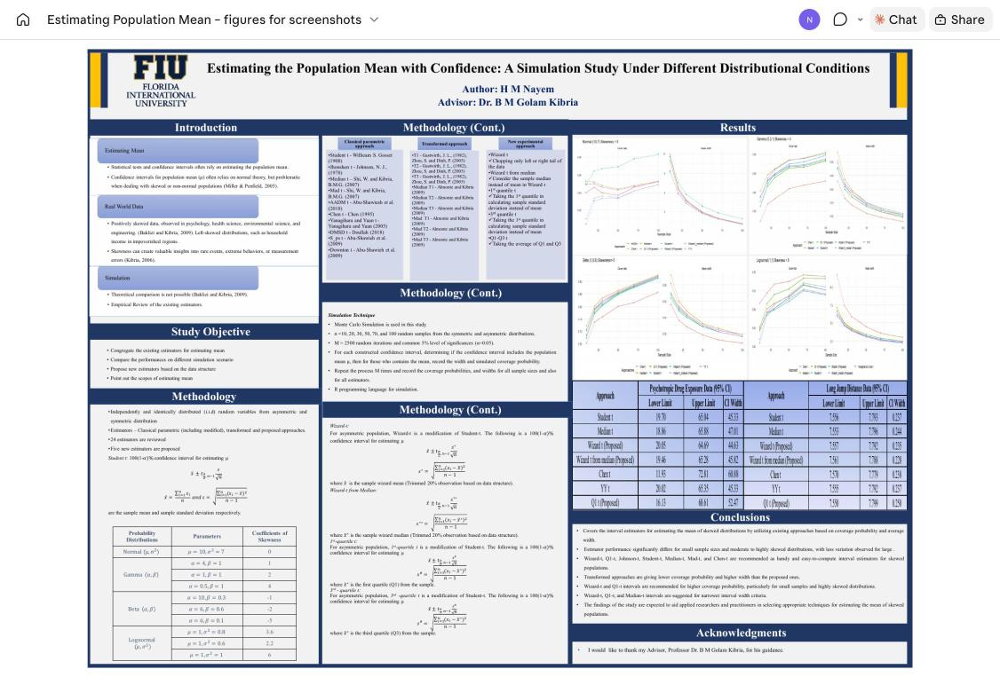
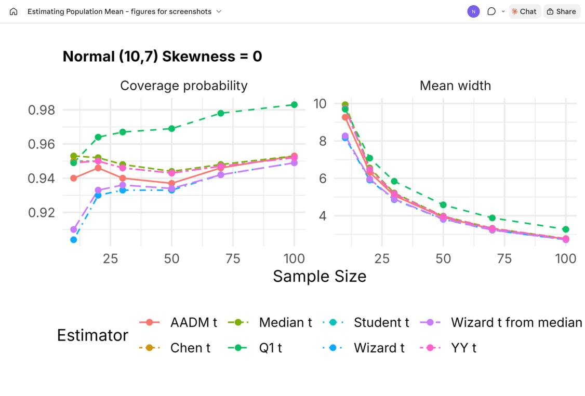
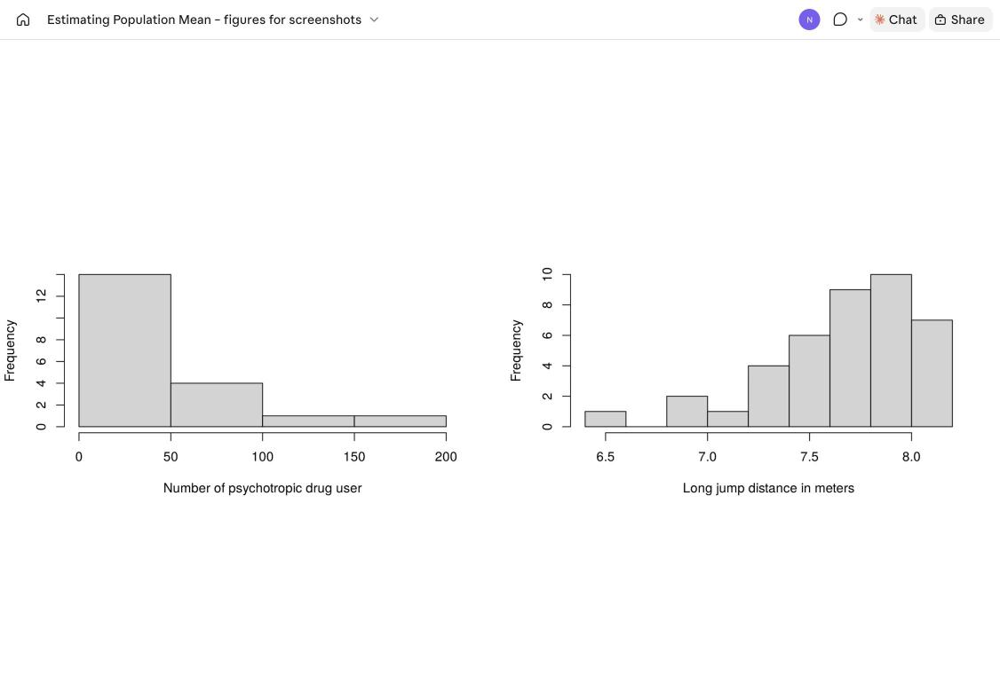

# Estimating Population Mean

**A Simulation Study on Some Confidence Intervals for Estimating the Population Mean Under Asymmetric and Symmetric Distribution Conditions**

HM Nayem & BM Golam Kibria, Department of Mathematics and Statistics, Florida International University

*Journal of Statistics Applications & Probability Letters* **11**(3), 123–144 (2024)
**DOI: [10.18576/jsapl/110303](https://doi.org/10.18576/jsapl/110303)**



## Summary

Confidence intervals (CIs) for a population mean usually rely on the normal or Student-t approximation, which
breaks down when data are skewed or contain outliers. This study compares **24 interval estimators** in a Monte Carlo
simulation:

- **Classical:** Student t, Johnson t, Median t, Mad t, AADM t, Chen t, Yanagihara–Yuan t, DMSD t, S_ps t, Downton t
- **Transformation-based:** T1, T2, T3, Median T1–T3, MAD T1–T3 (Hall; Zhou & Dinh; Almonte & Kibria)
- **Proposed:** **Wizard t**, **Wizard t from median**, **Q1 t**, **Q3 t** and **Q1Q3 t**

The proposed estimators replace the SD in the t interval with an SD measured around a *wizard* (20 %-chopped)
mean or median, or around a quartile.

**Design:** Normal, Beta, Gamma and Lognormal populations with skewness from −5 to +6; n = 10, 20, 30, 50, 70, 100;
M = 2,500 replications; 95 % level. The criteria are coverage probability and mean interval width.

**Main findings**

| Situation | Recommended |
|---|---|
| Symmetric data, small n | **Student t**: nominal coverage, shortest width |
| Skewed data, moderate n (> 50) | Proposed **Wizard t, Wizard t from median, Q1 t, Q3 t, Q1Q3 t**: consistently higher coverage with competitive width |
| Skewed data, smaller n | Median t, AADM t, Median T1, Chen t, YY t |

Two real-life datasets, psychotropic-drug exposure (right-skewed) and long-jump distances (left-skewed), support the simulation results.



## Code

| File | What it does |
|---|---|
| [`R/ci_estimators.R`](R/ci_estimators.R) | `ci_estimators(x)` returns all 24 CIs for a sample; `simulate_ci()` runs the Monte Carlo study |
| [`R/reproduce_paper.R`](R/reproduce_paper.R) | Reproduces the simulation tables (3.1–3.4) and the real-data tables (3.5, 3.6) |

```r
source("R/ci_estimators.R")
x <- read.csv("data/psychotropic_drug_exposure.csv")$users
ci_estimators(x, trim = "upper")          # 95 % CIs from all 24 estimators

# coverage and width for Gamma(0.5, 1) samples
set.seed(965)
simulate_ci(function(n) rgamma(n, 0.5, 1), mu = 0.5, trim = "upper")
```

```bash
Rscript R/reproduce_paper.R     # ~1 min, writes results/*.csv
```

The `trim` argument sets which tail the wizard estimators chop: `"upper"` for right-skewed data, `"lower"`
for left-skewed data, `"both"` for symmetric data. The code is base R, with no packages needed.
It is a condensed version of the original analysis scripts and gives **identical** results.

## Data

| File | n | Description | Shape |
|---|---|---|---|
| [`data/psychotropic_drug_exposure.csv`](data/psychotropic_drug_exposure.csv) | 20 | Number of psychotropic-drug users among non-antipsychotic drug users, across drug categories | right-skewed (skew 1.57); mean 42.37, SD 48.43 |
| [`data/long_jump_distance.csv`](data/long_jump_distance.csv) | 40 | Final long-jump distances (m) of 40 athletes | left-skewed (skew −1.16); mean 7.6745, SD 0.37 |
| [`data/psychiatric_disorders.csv`](data/psychiatric_disorders.csv) | 11 | Additional example (not in the paper) | right-skewed (skew 0.92) |



Simulated populations (Table 2.1 of the paper):

| Distribution | Parameters | Skewness |
|---|---|---|
| Normal | μ = 10, σ = 7 | 0 |
| Gamma | (4, 1), (1, 1), (0.5, 1) | 1, 2, 4 |
| Beta | (10, 0.3), (6, 0.6), (6, 0.1) | −3, −2, −5 |
| Lognormal | (1, 0.6), (1, 0.8), (1, 1) | 2.2, 3.6, 6 |

## Notes

Rerunning the code shows three issues in the published tables. See [`docs/reproducibility.md`](docs/reproducibility.md).

1. **DMSD-t coverage** in Tables 3.1–3.4 repeats the MAD-T3 coverage, because of an index error in the original
   scripts. This code reports the correct values: for example, Normal at n = 10 gives 0.962, not 0.658.
2. Table 3.3's **Gamma (skewness 4)** block repeats the Beta (skewness −3) numbers.
3. Several cells of **Table 3.5** were mistyped, most by exactly 10.

## Citation

```bibtex
@article{nayem2024ci,
  author  = {Nayem, H. M. and Kibria, B. M. Golam},
  title   = {A Simulation Study on Some Confidence Intervals for Estimating the Population Mean
             Under Asymmetric and Symmetric Distribution Conditions},
  journal = {Journal of Statistics Applications \& Probability Letters},
  volume  = {11}, number = {3}, pages = {123--144}, year = {2024},
  doi     = {10.18576/jsapl/110303}
}
```

## References

[1] Neyman, J. (1937). Outline of a theory of statistical estimation based on the classical theory of probability. Philosophical Transactions of the Royal Society of London. Series A, Mathematical and Physical Sciences, 236, 333–380.

[2] Chen, L. (1995). Testing the mean of skewed distributions. Journal of the American Statistical Association, 90, 767.

[3] Baklizi, A., and Kibria, B. M. G. (2009). One and two sample confidence intervals for estimating the mean of skewed populations: an empirical comparative study. Journal of Applied Statistics, 36, 601–609.

[4] Banik, S., and Kibria, B. M. G. (2010). Comparison of some parametric and nonparametric type one sample confidence intervals for estimating the mean of a positively skewed distribution. Communications in Statistics - Simulation and Computation, 39, 361–389.

[5] Ghosh, S., and Polansky, A. M. (2016). New bootstrap confidence intervals for means of positively skewed distributions. Communications in Statistics - Theory and Methods, 45, 6915–6927.

[6] Mudelsee, M., and Alkio, M. (2007). Quantifying effects in two-sample environmental experiments using bootstrap confidence intervals. Environmental Modelling & Software, 22, 84–96.

[7] Andersson, P. G. (2004). Alternative confidence intervals for the total of a skewed biological population. Ecology, 85, 3166–3171.

[8] Shi, W., and Kibria, B. M. G. (2007). On some confidence intervals for estimating the mean of a skewed population. International Journal of Mathematical Education in Science and Technology, 38, 412–421.

[9] Zhou, X. H. (2005). Nonparametric confidence intervals for the one- and two-sample problems. Biostatistics, 6, 187–200.

[10] Abu-Shawiesh, M. O. A., and Saghir, A. (2020). Robust confidence intervals for the population mean alternatives to the Student-t confidence interval. Journal of Modern Applied Statistical Methods, 18, 2–20.

[11] Luh, W., and Guo, J. (2001). Transformation works for non-normality? On one-sample transformation trimmed t methods. British Journal of Mathematical and Statistical Psychology, 54, 227–236.

[12] Baklizi, A. (2008). Inference about the mean of a skewed population: a comparative study. Journal of Statistical Computation and Simulation, 78, 421–435.

[13] Abu-Shawiesh, M. O. A., Banik, S., Kibria, B. M. G., and Akyüz, H. E. (2020). A comparison of some modified confidence intervals based on robust scale estimators for process capability index. Production Engineering, 14, 217–229.

[14] Abu-Shawiesh, M. O. A., et al. (2018). Confidence intervals based on absolute deviation for population mean of a positively skewed distribution. International Journal of Computational and Theoretical Statistics, 5, 1–13.

[15] Sinsomboonthong, J., Abu-Shawiesh, M. O. A., and Kibria, B. M. G. (2020). Performance of robust confidence intervals for estimating population mean under both non-normality and in presence of outliers. Advances in Science, Technology and Engineering Systems Journal, 5, 442–449.

[16] Abu-Shawiesh, M. O. A., Sinsomboonthong, J., and Kibria, B. M. G. (2022). A modified robust confidence interval for the population mean of distribution based on deciles. Statistics in Transition New Series, 23, 109–128.

[17] Almonte, C., and Kibria, B. M. G. (2009). On some classical, bootstrap and transformation confidence intervals for estimating the mean of an asymmetrical population. Model Assisted Statistics and Applications, 4, 91–104.

[18] Johnson, N. J. (1978). Modified t tests and confidence intervals for asymmetrical populations. Journal of the American Statistical Association, 73, 536–544.

[19] Gastwirth, J. L. (1982). Statistical properties of a measure of tax assessment uniformity. Journal of Statistical Planning and Inference, 6, 1–12.

[20] Yanagihara, H., and Yuan, K. (2005). Four improved statistics for contrasting means by correcting skewness and kurtosis. British Journal of Mathematical and Statistical Psychology, 58, 209–237.

[21] Hall, P. (1992). On the removal of skewness by transformation. Journal of the Royal Statistical Society Series B, 54, 221–228.

Contact: HM Nayem, hnaye001@fiu.edu
